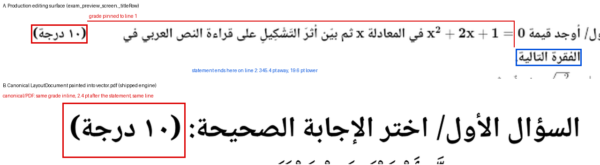
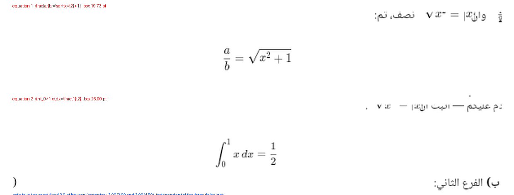

# دراسة هندسية: موضع الدرجة والمسافة حول المعادلة المستقلة

**النطاق:** دراسة وتشخيص فقط — **لا تعديل على كود الإنتاج** في هذه المرحلة.
**الفرع:** `arena/c08372c2-writing-questions` · **خط الإنتاج المجمَّد:** `c45655c`

> **قيد وارد أولًا (بصراحة):** الصورتان المرفقتان في الطلب **لم تُوصَل إلى بيئة
> التنفيذ** (وصل وصفهما لا ملفّاهما). لذلك لم أستخرج «الهيئة المطلوبة» من صورة
> بل من **النموذج المرجعي داخل المشروع نفسه**: عقد العنوان في
> `lib/layout/visual/visual_document.dart`، وقواعد `LayoutEngine._titleBlock`،
> وسجل العقد `lib/layout/visual/export_contract_audit.dart`
> («سطر العنوان: الرقم ← المنطوق ← الدرجة»)، ثم قِيس الفرق على مخرجات حقيقية.
> كل ما يلي قابل للتحقق بالأمر الواحد المذكور في §8. والمقارنة البصرية
> موجودة في §8.6: لوحات مقصوصة من الأدلة الحقيقية نفسها (سطح الإنتاج و`vector.pdf`)،
> لا رسوم توضيحية، مع خطوط قياس على المواضع المختلفة.

---

## 1. العرض الأولي (المرجع المطبوع)

| الطبقة | الملف | المسؤول |
|---|---|---|
| الخطة | `lib/views/wizard/canonical_preview_plan_controller.dart` | يطلب الحسم المتزامن مع المستند ويحفظ `CanonicalPagePlan` |
| المحرّك | `lib/layout/canonical/layout_engine.dart` | `_titleBlock` (873) · `_contentBlock` (930) · `_paragraphBlock` (1006) |
| القياس | `lib/layout/canonical/flutter_text_metrics.dart` | `layoutParagraph` — `TextPainter` + `WidgetSpan` بمقاس `mathBox` |
| قياس الرياضيات | `lib/layout/canonical/layout_math_metrics_resolver.dart` | لقطات `MathSnapshotRenderer` → `LayoutMathBox` بالسنتيمتر/النقطة |
| الرسم | `lib/layout/canonical/canonical_layout_preview.dart` | `CanonicalLayoutPreviewPage` — يرسم إحداثيات `LayoutDocument` كما هي |
| الصفحات | `lib/layout/canonical/canonical_page_plan.dart` | `CanonicalPagePlan`, `CanonicalPagePlanFragment`, `titleHeightPtOf` |

**كيف يحدد موضع الدرجة هنا؟** الدرجة **ليست عنصرًا مستقلًا**: `_titleBlock`
يبنيها كـ`MetricSpan` داخل فقرة سطر العنوان نفسها:

```
label  ⟶ separator ⟶ 4px فجوة ⟶ statement ⟶ NBSP ⟶ marks
```
(`layout_engine.dart:880-916`، والفجوة قبل الدرجة `_nonBreakingGap` تُنفَّذ كحرف
U+00A0 مقيس بخط السطر نفسه، تعليق السطور 903-913).

النتيجة الهندسية: **الدرجة تتبع آخر سطر من المنطوق**، لا حافة الصف، ولا يمكن أن
تنفصل عنه لأن U+00A0 يحمل صنف UAX #14 = GL.

---

## 2. واجهة العرض والتعديل (سطح الإنتاج)

**هذا هو السطح الذي يراه المدرس فعلًا**، وهو ليس السطح القانوني:

```dart
// lib/views/wizard/exam_wizard_screen.dart:160
return ExamPreviewScreen(
  key: const ValueKey<WizardStep>(WizardStep.preview),
  onBackToQuestions: () => _goTo(WizardStep.questions),
);
```
بلا `canonicalLayoutResolver` ولا `canonicalPreviewAssetLoader`، وبهما فقط:

```dart
// lib/views/wizard/exam_preview_screen.dart:618
bool get _useCanonicalSurface =>
    widget.canonicalLayoutResolver != null &&
    widget.canonicalPreviewAssetLoader != null;
```

إذن في الإنتاج `_useCanonicalSurface == false`، ويُرسم
`_buildPaperZoomedPage` → `_buildPage` → `_buildQuestionBlock` (ودجات Flutter).

| المسؤولية | الملف:السطر | الطريقة |
|---|---|---|
| صف العنوان | `exam_preview_screen.dart:5912` `_titleRow` | `Row[ dragHandle, label(≤34%), gap 4px, **Expanded(statement)**, marks(≤26%), actions ]` |
| الدرجة | `exam_preview_screen.dart:6292` `_marksTarget` | ودجة مستقلة في نهاية الـ`Row`؛ وعند غيابها تُطبع «+ درجة» رمادية 10px |
| المنطوق | `_paperField` → `lib/views/widgets/paper_field.dart:317-370` | `TextField` حقيقي أثناء التحرير، و`TexText` حين يُترك |
| المعادلة المستقلة | `lib/views/widgets/tex_text.dart:110-133` | `Text.rich` مستقل + `Padding(vertical: 4)` + `TextAlign.center` |
| الترقيم والصفحات | `_buildPage:4879` · `_planRowHeight:5950` · `_buildQuestionFragmentSlice:5967` | من الخطة: ارتفاع سطر العنوان، نافذة المقطع، فجوة الترويسة |
| ارتفاع عنوان الفرع | `plan?.branchTitleHeightPtOf(...)` (6563) | من الخطة |

**الخلاصة البنيوية:** السطح التفاعلي يأخذ من الخطة **ثلاثة أشياء فقط**: حدود
الصفحات/المقاطع، ارتفاع صف العنوان، وفجوة الترويسة. أما **مواضع العناصر داخل
السطر** فتقرّرها `Row`/`Expanded`/`TextField` — أي محرّك تخطيط ثانٍ.

---

## 3. PDF

| الطبقة | الملف | المسؤول |
|---|---|---|
| الواجهة | `lib/pdf_engine/paginated_pdf_exam_engine.dart:52-100` | `generate` — `layoutDocument ?? CanonicalLayoutService.resolve(...)` ثم `painter.paintPage` |
| الرسم | `lib/pdf_engine/canonical_layout_pdf_painter.dart:226-300` | يرسم كل `LayoutRun` في `x` و`baseline` من المستند، والمعادلات كصور لا نصًا |
| الرياضيات | `lib/pdf_engine/pdf_math_rasters.dart` + `lib/services/math_snapshot_renderer.dart` | لقطة `SafeMathTex` نفسها التي تعرضها اللوحة (لا محرك رياضيات ثانٍ) |
| التصدير الفعلي | `lib/services/pdf_export_service.dart:55-70` | `exportDocumentToPdf` **لا يمرّر** `layoutDocument` → `resolve` جديدة |

PDF لا يعيد حساب أي موضع: يرسم إحداثيات `LayoutDocument` حرفيًا. أي أن **مرجع
الموضع هو المحرّك**، وPDF طابع مطيع له.

---

## 4. جدول مقارنة القواعد

| القاعدة | العرض القانوني (المرجع) | واجهة العرض والتعديل | PDF |
|---|---|---|---|
| موضع الدرجة | جريان نصي داخل فقرة العنوان بعد المنطوق (`_titleBlock:903-916`) | ودجة في نهاية `Row` بعد `Expanded` (`_titleRow:5912`) | من `LayoutRun` — مطابق للمرجع |
| انفصال الدرجة عن المنطوق | مستحيل (U+00A0 يمنع كسر السطر) | **ممكن**: تبقى على السطر الأول بينما المنطوق يلتفّ | مستحيل |
| درجة بلا قيمة | لا شيء يُطبع | «+ درجة» رمادية (أداة تحرير لا تُطبع) | لا شيء |
| عرض المنطوق | عمود كامل ناقص التسمية | ناقص عرض صندوق الدرجة (`maxWidth: 26%`) | كالمرجع |
| التعريف «مستقلة» للمعادلة | `TexContent._blockPattern` = `$$…$$` (`tex_content.dart:6`) | **نفس المصدر**: `RichContent.parse` ← `TexContent.split` | **نفس المصدر** |
| فراغ قبل/بعد المعادلة المستقلة | `LayoutUnits.pxToPt(4)` = 3pt (`layout_engine.dart:998`) | `EdgeInsets.symmetric(vertical: 4)` = 4px = 3pt على المقياس نفسه | 3pt من المرجع |
| محاذاة المعادلة | `PaperAlign.center` مفروضة | `TextAlign.center` | من المرجع |
| ارتفاع المعادلة | `mathBox` من اللقطة، وإلا `fontSizePt` (احتياط) | الودجة الحقيقية (ارتفاع الحبر والهبوط) | ارتفاع اللقطة |
| أثناء التحرير | — | نافذة `mixed_content_editor` منفصلة عن الورقة (القياس: 8.4) | لا يوجد «تحرير» |
| ترتيب/التفاف النص | `TextPainter` بإحداثيات PT | `TextField` بوحدات px مع `_CaretGutter` | من المرجع |
| RTL/BiDi | `DocumentDirection` من المصدر | يرث اتجاه اللوحة + `Directionality` | نفس المصدر |
| القياسات | نقطة (pt) | بكسل منطقي (px) بتحويل 96/72 | نقطة (pt) |

---

## 5. موضع الدرجة الصحيح وفق المرجع

وفق عقد المشروع نفسه:

* `visual_document.dart:16-22` — «سطر عنوان (رقم ← منطوق ← درجة)».
* `export_contract_audit.dart:156` — «سطر العنوان: الرقم ← المنطوق ← الدرجة».
* `branch_model.dart:14` — «الرقم ← [statement] ← الدرجة».
* `layout_engine.dart:903-913` — الفجوة قبل الدرجة NBSP مقيس، لا `SizedBox`.

**إذن الموضع الصحيح:** نفس سطر العنوان، **ملتصقة بنهاية المنطوق** بفجوة حرف
واحد غير قابلة للكسر، وتظهر على يسار المنطوق في RTL لأنها آخر ما في السطر
منطقيًا — **لا** على حافة الصف، ولا في صندوق مستقل، ولا كزر «+ درجة» داخل الورقة.

الدرجة **مرتبطة بالسؤال كلّه** لا بكل فقرة: `QuestionModel.marks`
(`question_model.dart:141-144`) = `marksOverride` أو مجموع درجات الفروع والنقاط؛
والفروع والنقاط لها درجاتها المستقلة (`BranchModel.marks`, `BranchItem.marks`)،
وكلها تُطبع في سطر عنوان صاحبها. فالبنية ثلاثية المستويات، لا ثنائية.

---

## 6. المعادلة المستقلة: المسافة والمحاذاة المطلوبة

**قبل الإصلاح المزعوم، هذه هي القاعدة القائمة فعلًا:**

* تُعرَّف ب`$$…$$` (`tex_content.dart:6`)، وتصل إلى المحرك كـ`MetricSpan.isBlockMath`.
* المحرك يفصلها عن النص إلى فقرة مستقلة (`_contentBlock:960-1005`)، يفرض عليها
  `PaperAlign.center`، ويضع قبلها وبعدها `LayoutUnits.pxToPt(4)` = **3pt**.
* السطح التفاعلي يفعل الشيء نفسه بالضبط: بلوك `Text.rich` مستقل + `4px` رأسي =
  **3pt** على مقياس الورقة.

**إذن الفجوة المطلوبة هي 3pt قبل و3pt بعد**، وهي اليوم **ثابتة لا تتعلّق
بارتفاع المعادلة**. هذا هو جوهر الملاحظة: معادلة بكسر/جذر (ارتفاعها ضعف سطر
النص) تحصل على فراغ سطر عادي، فتبدو ملتصقة بالنص فوقها وتحت. القاعدة الصحيحة
ليست «padding عشوائي» بل **فجوة مشتقة من هندسة الصندوق**:

```
gapBefore = max(3pt, (mathBox.heightPt - lineHeightPt) / 2)
```
أي نصف الفارق بين ارتفاع الصندوق الرياضي وارتفاع سطر النص، بأرضية 3pt — وهذا
يعني أن المعادلة الطويلة تدفع النص تلقائيًا، والقاعدة تُشتق من `mathBox` الذي
يُحسب أصلًا في `LayoutMathMetricsResolver` ولا يستهلكه المحرك في الفراغ.

---

## 7. السبب الجذري لكل اختلاف

| # | الاختلاف | السبب الجذري | الدليل |
|---|---|---|---|
| 1 | الدرجة على حافة الصف بدل نهاية المنطوق | `Expanded(statement)` يدفع `marks` إلى نهاية `Row` | `exam_preview_screen.dart:5925-5940` |
| 2 | الدرجة تنفصل عن المنطوق عند التفاف السطر | الدرجة خارج فقرة النص، فلا يشاركها محرك الكسر | مقارنة §4 + القياس في §8 |
| 3 | «+ درجة» تظهر داخل الورقة | `_marksTarget` يرسم بديلًا تحريريًا داخل الصف | `exam_preview_screen.dart:6313-6325` |
| 4 | عرض المنطوق أقل من الطباعة | صندوق الدرجة محجوز مسبقًا (≤26%) | `_titleRow:5935-5941` |
| 5 | الدرجة تتحرك عند تنشيط نقطة | أدوات النقطة تُدرج **بعد** الدرجة في `Row` | `_pointRow:6739-6760` |
| 6 | المعادلة تُحرَّر خارج الورقة | نافذة `mixed_content_editor` بدل تحرير في المكان | لقطة `edit_surface_active.png` + `paper_field.dart` (`onActivate`) |
| 7 | فراغ المعادلة لا يكبر مع ارتفاعها | 3pt ثابتة | `layout_engine.dart:998` · `tex_text.dart:120` |
| 8 | احتمال قياس رياضيات مختلف | احتياط `heightPt = fontSizePt` عند غياب اللقطات | `flutter_text_metrics.dart:245-256` |
| 9 | ارتفاع سطر العنوان مفروض من الخطة على ودجات قد تكون أطول | `_planRowHeight` `SizedBox` | `exam_preview_screen.dart:5950-5956` |
| 10 | الدرجة على السطر الأول بينما المنطوق يلتفّ | الودجة خارج فقرة النص فلا تشاركها الكسر | قياس §8.2: الدرجة عند `y=288.5pt` وآخر حبر للمنطوق عند `308.1pt` (فرق 19.6pt)، وأفقيًا 346.2pt |
| 11 | فراغ المعادلة لا يتبع ارتفاعها | `pxToPt(4)` ثابت | قياس §8.3: 3.00pt قبل/بعد مهما كان ارتفاع الصيغة |

**ما هو منفي بالأدلة:** ليس اختلافًا في نموذج البيانات (الدرجة واحدة،
`question_model.dart:141`)، ولا في ترتيب العناصر في `DocumentIR`
(`document_ir.dart` يبني العنوان من المصدر نفسه)، ولا في RTL/BiDi (كلاهما من
`DocumentDirection`)، ولا تعريف المعادلة المستقل (مصدر واحد: `TexContent.split`).

---

## 8. إعادة الإنتاج والقياس

الحالة: مستند واحد، صفحة واحدة، يُقاس ثلاث مرات في تشغيل CI واحد
(`ec7a568`، تشغيل `41374495682`)، ووسمُ الدليل
`Original element geometry review transport` (سحب متحقَّق بالـchecksum).

**المستند المقيس:** سؤال بمنطوق يلتفّ على سطرين + درجة ١٠، ومتن فيه ثلاث
معادلات (`$…$` و`$…$` و`$$\frac{a}{b}=\sqrt{x^{2}+1}$$` مستقلة)، ومشكّل عربي،
ونقطة اختيار من متعدد، وفرعان بدرجتين (٥ و٣) وفي أحدهما معادلة مستقلة
`$$\int_{0}^{1}x\,dx=\frac{1}{2}$$`، ثم سؤال تالٍ بدرجة ٧.

### 8.1 الدرجة — المرجع القانوني (نفس ما يطبعه PDF)

جريانات سطر العنوان كما ينتجها `LayoutEngine` (إحداثيات pt من يسار الصفحة):

| السؤال | '(' الدرجة | ')' الدرجة | نهاية المنطوق | الفجوة | السطر |
|---|---|---|---|---|---|
| سؤال ١ (منطوق سطران) | x=519.14 | x=480.41 | '.' عند 525.97 | **2.43pt** (عرض U+00A0) | السطر الثاني (index 1) |
| الفرع الأول | 474.17 | 443.67 | ':' عند 480.12 | **2.32pt** | السطر الوحيد |
| الفرع الثاني | 466.52 | 436.03 | ':' عند 472.47 | **2.32pt** | السطر الوحيد |
| السؤال التالي | 419.30 | 385.93 | '.' عند 426.13 | **2.43pt** | السطر الوحيد |

قراءة السطر نفسه من اليمين إلى اليسار تعطي: `الرقم ← التسمية ← المنطوق ← U+00A0 ← (١٠ درجة)`
— أي أن الدرجة **جزء من جملة العنوان**، لا عنصر مجاور لها.

**تعريف الفجوة المستخدم في العمود أعلاه:** `statementEndX − marksEndX` أي من آخر
حرف إلى **الحافة القريبة** لمجموعة الدرجة، وهي تساوي عرض U+00A0 بالضبط. تنبيه
للقارئ: الحقل `gapPt` داخل `geometry.json` يقيس إلى **الحافة البعيدة**
(525.97−480.41 = 45.56 لسؤال ١) فليس هو المسافة البصرية؛ والحقل `trueEnd`
كذلك لا يعني أن الدرجة نهاية الفقرة. أول من يقرأ الملف قد يخطئ في الاثنين.
لاحظ أيضًا `lineIndex: 1` لسؤال ١: الدرجة في المرجع على **السطر الأخير** من
المنطوق، وهو مربط الفرق كلّه.

**إثبات بصري من PDF حقيقي** (سطر عنوان في `vector.pdf` للتركيبة البصرية،
صفحة 1 عند 300dpi): «السؤال الأول/ اختر الإجابة الصحيحة: (١٠ درجة)» — الدرجة
ملتصقة بالنقطتين في نهاية السطر نفسه.

### 8.2 الدرجة — سطح الإنتاج (ما يراه المدرس)

| القياس | القيمة (pt) |
|---|---|
| اتجاه المستند / الاتجاه المحيط بالسطح | `rtl` / `rtl` (متطابقان) |
| حقل المنطوق: الحد الأيسر داخل الصفحة | 88.6 |
| عرض حقل المنطوق | 392.3 |
| ارتفاع حقل المنطوق | 37.5 (= سطران) |
| **موضع الدرجة (سؤال ١)** | الحد الأيسر **42.5** = هامش الصفحة، أعلى السطر **الأول**، عرض الصندوق **46.13** |
| الحافة اليمنى لصندوق الدرجة | **241.02** = الحافة اليسرى لحقل المنطوق نفسه (الفجوة بينهما = حشو الحقل الداخلي 4.5pt فقط) |
| البعد من حبر الدرجة إلى آخر حبر في المنطوق | **346.2pt** (قياس بكسل: 460px على 1.3288px/pt) |
| الفرق الرأسي بين أعلى الدرجة وأعلى السطر الأخير | **19.6pt ≈ سطر كامل (18.75)** |
| درجة الفرع الأول/الثاني | 42.5 / 42.5 (كلتاهما على الهامش، وعلى سطر عنوان الفرع نفسه) |

**الفرق الجذري بالأرقام:** في المرجع تبعد الدرجة **2.4pt** عن آخر حرف وتقع على
**سطر المنطوق الأخير (`lineIndex: 1`)**. في سطح الإنتاج تبعد **346.2pt** عن آخر
حبر في المنطوق وتقع على **السطر الأول**، أي أعلى من نهاية الجملة بسطر كامل.

> **تصحيح ذاتي موثَّق:** النسخة الأولى من هذا التقرير كتبت «46.1pt» مسافةً بين
> الدرجة والمنطوق. المراجعة على `geometry.json` أظهرت أن 46.13 هو **عرض صندوق
> الدرجة** لا الفجوة، وأن الحافة اليمنى للصندوق تلامس حقل المنطوق نفسه (حشو
> داخلي 4.5pt). الرقم الصحيح للمسافة إلى نهاية المنطوق هو **346.2pt**، وهو أسوأ
> من التقدير الأول لا أهون. الفرق عرضيّ في جوهره لكنه يتبع سطرًا خاطئًا.

### 8.3 المعادلة المستقلة — المرجع مقابل الإنتاج

| القياس | المرجع (`LayoutDocument`) | سطح الإنتاج | الحكم |
|---|---|---|---|
| ارتفاع المعادلة ١ | 19.50 | 19.70 | متطابق عمليًا (Δ0.2pt) |
| ارتفاع المعادلة ٢ (تكامل) | 26.25 | 26.00 | متطابق عمليًا (Δ0.25pt) |
| الفجوة قبل المعادلة ١ | 3.00 | 3.00 (4px = 3pt) | **متطابقة** |
| الفجوة بعد المعادلة ١ | 3.00 | 3.00 | **متطابقة** |
| الفجوة قبل/بعد معادلة الفرع | 3.00 / 4.50 | 3.00 / 3.00 | فارق 1.5pt في «بعد» فقط (جاره سطر متن لا فقرة) |
| المحاذاة | `PaperAlign.center` | `TextAlign.center` | متطابقة |
| مصدر قياس الرياضيات | `mathSnapshot` | الودجة الحقيقية | نفس المحرك |

**نتيجة مهمة تنفي الفرضية:** فراغ المعادلة في المعاينة **مطابق** لفراغها في
الـPDF؛ لا يوجد انحراف بين راسمين هنا. المشكلة الحقيقية أن الرقم **3pt ثابت**
لا يُشتق من ارتفاع الصيغة: معادلة ارتفاعها 26.25pt داخل سطر ارتفاعه 18.75pt
تحتاج فراغًا أكبر من 3pt كي تُقرأ منفصلة.

### 8.4 ماذا يحدث عند التحرير؟

النقر على متن يحوي صيغة **لا** يحوّل الحقل إلى `TextField` خام: يفتح
`mixed_content_editor` كنافذة (لقطة `edit_surface_active.png`). القياس:
`displayMath` في الشجرة 2 قبل النقر و3 بعده (النافذة تعرض معاينة إضافية)، ولا
يوجد `EditableText` داخل حقل المتن. إذن «فقدان الفصل البصري» يقع في **النافذة
المنفصلة** حيث تُحرَّر الصيغة كمقطع نصي بين مقاطع، لا في الورقة.

### 8.5 كيف يُعاد القياس

```
# في CI: خطوة "Measure mark and display-equation placement on both surfaces"
flutter test test/visual/diag_marks_equation_geometry_test.dart
python3 tool/evidence_review_transport.py fetch --run <run> \
  --job-name 'Original element geometry review transport' --destination ./out
```
الملفات: `geometry.json` (كل الأرقام أعلاه)، `edit_surface.png`،
`edit_surface_active.png`، `reference_preview.png`. **حدّ معلن:** لقطة السطح
القانوني التُقطت قبل جهوز صور الرياضيات فظهر دوّار الانتظار؛ لذلك اعتُمد على
هندسة `LayoutDocument` الرقمية + PDF التركيبة البصرية كإثبات بصري للمرجع، ولم
يُعدّ ظهور الدوّار نجاحًا.


### 8.6 الصور المقارنة (مولَّدة من الأدلة نفسها، لا رسوم توضيحية)



* **(أ)** لقطة حقيقية لسطح الإنتاج (`edit_surface.png`، تشغيل `41374495682`):
  الدرجة `(١٠ درجة)` في إطار أحمر على أقصى يسار السطر **الأول**، والمنطوق يكمل
  إلى سطر ثانٍ ينتهي عند الإطار الأزرق — المسافة المقيسة بين الحبرين 346.2pt
  والفرق الرأسي 19.6pt.
* **(ب)** نفس الشيء في المسار القانوني كما يطبع في `vector.pdf` (محرّك الشحن،
  تكبير 300dpi): الدرجة **داخل السطر نفسه** بعد المنطوق بـ2.4pt، ولا وجود
  لصندوق مستقل ولا لسطر ثانٍ تفارقه.



معادلتان مستقلتان في سطح الإنتاج نفسه: ارتفاع صندوقهما 19.73pt و26.00pt
(المرجع: 19.50 و26.25)، وكلتاهما تأخذ **الفجوة الثابتة نفسها 3pt**، فالمعادلة
الأطول (التكامل) تظهر أقرب إلى سطر الفرع الذي يليها. الرقم هنا ليس انزياحًا بين
راسمين — بل قاعدة فراغ لا تقرأ `mathBox`.

### 8.7 فهرس الأدلة القابلة للتحقق

| الملف | sha256 (بادئة) | ماذا يثبت |
|---|---|---|
| `docs/review/evidence/marks_equation_geometry.json` | `624f554afcc4a4bc` | كل الأرقام في §8.1–8.3: `canonical.marks[]`, `canonical.blockMath[]`, `production.marksRectPt`, `production.displayMath[]` |
| `edit_surface.png` (حزمة التشغيل) | `54e7cc26d5e27dc2` | سطح الإنتاج كما يراه المدرس، ومنه قيس البكسل (1.3288px/pt) |
| `edit_surface_active.png` | `29110372b1f8784f` | حال التحرير: نافذة `mixed_content_editor`، و`displayMath` 2→3 |
| `vector.pdf` (تركيبة المعرض البصرية) | `5344f0f470778c89` | المرجع القانوني مطبوعًا، وعليه قيس فاصل 2.4pt |

القياس البكسلي تم على الصفحة نفسها بعد مطابقة مستطيلها من `pageRectPt`
(152.36, 135.0, 595.28, 841.89) مع حدود الورق في اللقطة: 1.3288px/pt أفقيًا،
1.3292px/pt رأسيًا — أي أن التحويل px↔pt ليس افتراضًا بل مقيسًا.

---

## 9. تشخيص المستوى

**الفرق المقيس بين المرجع والإنتاج نوعان لا ثلاثة:**
(1) الدرجة: عنصر مستقل في نهاية صفّ (**346.2pt** عن نهاية المنطوق، على السطر
الأول) بدل جريان نصي (2.4pt، على سطر المنطوق الأخير `lineIndex: 1`). (2) المعادلة: **لا فرق بين المعاينة وPDF** (الارتفاعات
والفراغات متطابقة ±0.25pt)؛ النقص في *قاعدة* الفراغ نفسها (3pt ثابتة).

**الخلل في Renderer لا في البيانات ولا في Recognition:**
نموذج البيانات سليم، و`DocumentIR` سليم، و`LayoutEngine` ينتج الموضع الصحيح
(الدرجة في نهاية المنطوق). الذي يختلف هو **الراسم**: سطح الإنتاج يرسم صفًا
مبنيًا بـ`Row` بدل أن يرسم `LayoutRun`، فيفقد العلاقة بين الدرجة والمنطوق.
والمسافة حول المعادلة: المحرك والراسم **متفقان على الرقم**، والرقم نفسه
**ناقص اشتقاقًا** (ثابت 3pt لا يقرأ `mathBox`).

---

## 10. خطة إصلاح (لا تُنفَّذ قبل الموافقة)

**الإصلاح الأول — الدرجة (جذري، صغير الحجم):**
1. في `_titleRow` يستبدل `Expanded(statement) + marks` بكتلة نصية واحدة:
   `RichText`/`Wrap` يحوي المنطوق والدرجة كأبناء `TextSpan` مع U+00A0 قبلها —
   أي **نفس عقد المحرك**. البديل الأخف: إبقاء الحقل لكن تحويل الدرجة إلى
   `WidgetSpan` ب`alignment: PlaceholderAlignment.baseline` **داخل** الحقل نفسه
   عبر `renderBuilder`، وترك `_marksTarget` للتحرير فقط (نقرة على الجملة).
2. حذف «+ درجة» من الورقة أو نقله إلى شريط خارج الورقة (نمط §19.15 المطبَّق
   أصلًا على أدوات السؤال).
3. إخراج أدوات النقطة من `Row` إلى طبقة علوية مطلقة (`Overlay`) حتى لا تحرّك
   الدرجة.

**الإصلاح الثاني — فراغ المعادلة (جذري):**
1. `layout_engine.dart:998` يستبدل `pxToPt(4)` بدالة مشتقة من `mathBox` وارتفاع
   السطر (المعروض في §6) — تُطبَّق قبل/بعد كل مقطع `isBlockMath`.
2. `tex_text.dart:113` يستخدم **نفس** الدالة عبر `VisualMetrics` (مصدر واحد،
   كما ينص تعليق `visual_metrics.dart:1-14`)، لا `EdgeInsets.symmetric(4)` محليًا.

**ملفات متوقعة التعديل:** `layout_engine.dart`, `visual_metrics.dart`,
`exam_preview_screen.dart` (`_titleRow`, `_marksTarget`, `_pointRow`),
`tex_text.dart`. **لا** تغيير في `question_model.dart` ولا `document_ir.dart`
ولا `layout_document.dart` ولا محرك PDF.

**اختبارات مطلوبة:**
1. `_titleRow` ← بوابة جديدة: مسافة الدرجة إلى نهاية المنطوق = فجوة NBSP
   المقيسة ±0.75pt (نفس تفاوت `preview_field_geometry_test.dart`).
2. التفاف: منطوق من سطرين ⇒ الدرجة على **السطر الثاني** (حالة اختبار صريحة).
3. `design: marks never render on the row's far edge` — يمنع الرجوع.
4. فراغ المعادلة: معادلة بكسر ارتفاعها > سطر ⇒ `gapBefore ≥ (h−lineHeight)/2`.
5. صورة مقارنة جديدة في `visual_parity_fixture_test` (سؤال بدرجة ومعادلة).

---

## 11. التأثيرات المتوقعة للإصلاح

| الميزة | التأثر |
|---|---|
| تخطيط الأسئلة والفروع والنقاط | يتغير **راتب** الدرجة فقط؛ لا ترقيم ولا نصوص |
| ترقيم الصفحات | قد يزيد ارتفاع سطر العنوان إذا التفّ المنطوق في مساحة أوسع (الأسوأ: سطر إضافي) — يُقاس بـ`test/layout/canonical/*` |
| PDF | يتغير ارتفاع المعادلة فقط عند وجود `$$…$$`؛ الإحداثيات تبقى من المحرك |
| Word/DOCX | لا مسار DOCX في هذا الإصدار |
| المحرر والـIME | `TextField` يبقى كما هو؛ الحقول لا تفقد متحكماتها (§19.9) |
| الأدلة | إعادة توليد لقطات `build/visual_parity` وتحديث القياسات |

**مخاطر:** تغيير `_titleRow` يمسّ كل سؤال/فرع/نقطة ⇒ يجب بوابات
`production_fragment_*` + `preview_field_geometry` + البوابة البصرية قبل الدمج،
ولا يُقبل الإصلاح إن نجح أحدها وفشل آخر.
